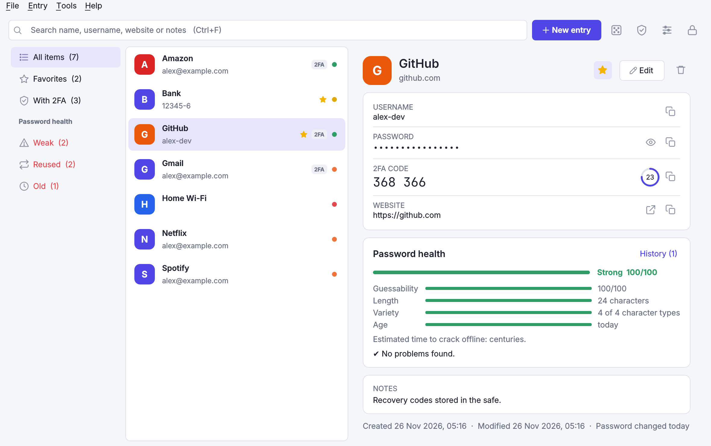

# PwMan: offline password manager

PwMan is a desktop password manager for Windows that stores everything in one encrypted file on your
computer. It has no account, no cloud and no sync, and it never makes network requests.



## Features

| | |
|---|---|
| **Master password + recovery key** | Everything is encrypted with a key derived from your master password. A random recovery key is created with the vault and can reset the master password if you forget it. |
| **2FA codes (TOTP)** | Each entry can store a 2FA secret and shows the current 6- or 8-digit code with a countdown, next to the password. You can paste the setup key, scan a QR code on screen, paste a screenshot, or open an image file. Google Authenticator "Transfer accounts" QR codes are also accepted. |
| **Password health rating** | Every password gets a score from 0 to 100, built from four sub-scores: **guessability** (dictionary words, keyboard patterns, common/leaked passwords, via zxcvbn), **length**, **character variety** and **age**. Reused passwords are flagged too. |
| **Password generator** | Choose the length (4–128), upper case, lower case, numbers and symbols, a **minimum count for each type**, the symbols allowed and characters to exclude, or avoid look-alike characters. Passphrase mode generates random words, e.g. `Tidal-Ember7-Gravel-Orchid-Canopy`. |
| **Security report** | A score for the whole vault, plus lists of weak, reused and old passwords and accounts without 2FA. |
| **Simple UI** | Search, favorites, one-click copy, light and dark themes, keyboard shortcuts. |

### Extra features added

- **Auto-lock** after a period of inactivity (default 5 min), when Windows is locked (Win+L), and optionally on minimize.
- **Clipboard protection.** Copied passwords are cleared after 30 s and kept out of Windows clipboard history and cloud clipboard.
- **Password history.** When you change a password, the old one is kept with the date it was replaced.
- **Encrypted automatic backups.** The first time you save in a session, PwMan copies the previous version of the vault to a `backups` folder and keeps the last 10. Each backup is a full vault that opens with your master password or recovery key.
- **Import** from Chrome, Edge, Firefox, Brave, Bitwarden, LastPass, 1Password, KeePass/KeePassXC, Proton Pass and Dashlane CSV exports. **Export** to CSV, which asks for your master password again.
- **Screen-capture protection** (optional) hides the window from screenshots and screen sharing.
- **Caps Lock warning** on password fields.
- **Readable passwords.** Revealed passwords show digits and symbols in different colours, so `0`/`O` and `1`/`l` are easier to tell apart.
- **Tamper detection.** If any byte of the vault file is changed, the change is detected.
- **Single-instance lock.** The same vault can't be opened in two windows, which could otherwise overwrite changes.

## Install (Windows 10/11)

1. Download `PwMan-Setup-<version>.exe` from the
   [Releases](https://github.com/eduardogott/pwman/releases) page, or from the latest
   [Build workflow run](https://github.com/eduardogott/pwman/actions/workflows/build.yml) (artifact at the bottom of the run page).
2. Run it. No administrator rights are needed. By default it installs for your user only, in
   `%LOCALAPPDATA%\Programs\PwMan`.
3. Start **PwMan** from the Start menu, create your vault, and **save your recovery key** somewhere offline.

> **"Windows protected your PC" / SmartScreen:** the installer isn't code-signed (a signing certificate
> costs money), so Windows may warn about an unknown publisher. Click **More info → Run anyway**. You can
> also build the installer yourself from this source code (see below).

### Where is my data?

| What | Location |
|---|---|
| Vault (encrypted) | `%APPDATA%\PwMan\vault.pwm` |
| Automatic encrypted backups | `%APPDATA%\PwMan\backups\` |
| Preferences (not secret: theme, window size, last vault path) | `%APPDATA%\PwMan\settings.json` |

Uninstalling PwMan does **not** delete your vault. To move PwMan to another PC, copy `vault.pwm` over and use
**File → Open vault…**. To restore a backup, open the backup file the same way.

## Security design

```
master password ──Argon2id (256 MiB, 4 passes)──► key A ──AES-256-GCM──┐
                                                                        ├─► wrapped copies of the vault key
recovery key ─────Argon2id (256 MiB, 4 passes)──► key B ──AES-256-GCM──┘

random 256-bit vault key ──AES-256-GCM──► entries + settings   (file header authenticated as AAD)
```

- **Argon2id** is a memory-hard key derivation function, so each password guess costs about 256 MiB of
  RAM. That makes GPU and ASIC brute-forcing very expensive. One unlock takes about 0.3–1 s.
- **AES-256-GCM** is authenticated encryption, so changes to the file are detected instead of producing garbage.
- The **recovery key** is 160 random bits, written as 32 easy-to-read characters (`XXXX-XXXX-…`). With
  either the master password or the recovery key you can open the vault, so keep the recovery key offline,
  for example printed or on a USB stick, and **not** next to the vault file.
- Changing the master password re-encrypts only the vault key. Your recovery key keeps working.
  Backups made *before* the change still open with the old password.
- Saves are **atomic** (written to a temporary file, checked, then renamed), so a crash or power cut can't
  leave a half-written vault.
- **No network code.** PwMan never connects to the internet, including for update checks, telemetry or
  favicons. The only time it opens anything online is when you click "Open website", which hands the
  link to your browser.

**Limitations.** Python can't reliably wipe secrets from RAM, so while the vault is unlocked its contents
are in the process's memory. Malware running as your user (a keylogger, for example) can capture your
master password; no password manager can protect against a compromised PC.

## Build from source

Requirements: Python 3.11+ and, for the installer, [Inno Setup 6](https://jrsoftware.org/isinfo.php).

```powershell
# run from source
python -m venv .venv
.venv\Scripts\pip install -r requirements.txt -e .
.venv\Scripts\python -m pwman

# full build: tests -> PyInstaller -> self-test -> installer in dist\
powershell -ExecutionPolicy Bypass -File build_windows.ps1
```

The GitHub Actions workflow (`.github/workflows/build.yml`) does the same on every push. It runs the
tests on Windows and Linux, builds the app, runs the built `.exe`'s self-test, builds the installer, then
installs it silently, runs the installed app and uninstalls it. To publish a release, push a tag such as
`v0.1.0`; the workflow attaches the installer to a GitHub Release.

Run the tests: `QT_QPA_PLATFORM=offscreen python -m pytest` (PowerShell: `$env:QT_QPA_PLATFORM="offscreen"`).

## Project layout

```
src/pwman/core/      Qt-free logic: crypto.py, vault.py, totp.py, strength.py, generator.py, csv_io.py, analysis.py
src/pwman/ui/        PySide6 interface (main window, dialogs, widgets, theme)
src/pwman/assets/    EFF passphrase wordlist
packaging/           PyInstaller spec, Inno Setup script, icon
tests/               pytest suite (crypto, RFC 6238 vectors, generator, scoring, CSV, UI flows)
```

## Ideas for later

- Auto-type: fill in the username, password and 2FA code in another app with a global hotkey.
- A browser extension that talks only to the local app (native messaging), still with no network access.
- Folders/tags, custom fields, file attachments.
- Large-type display, to read a password out when typing it on a TV or phone.
- Offline breach check against a downloaded copy of the Have I Been Pwned password list.
- Windows Hello (fingerprint/face) to unlock quickly after the first unlock.
